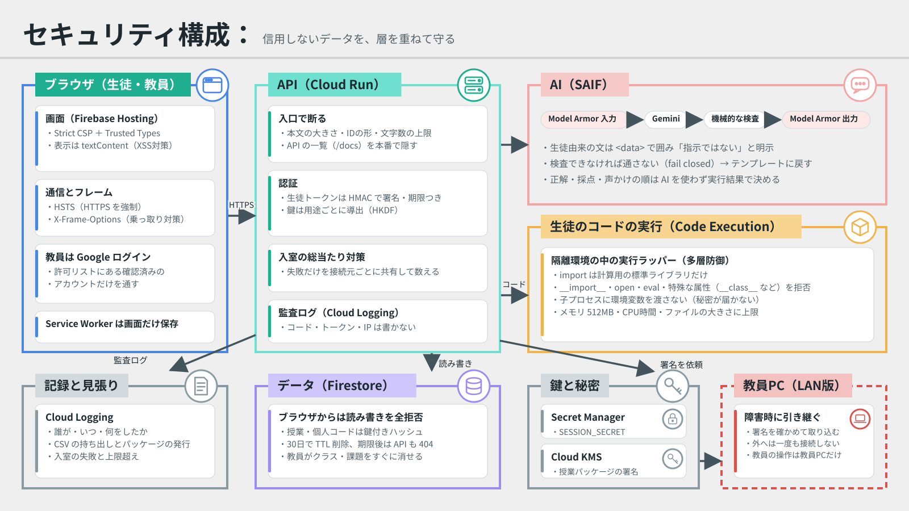
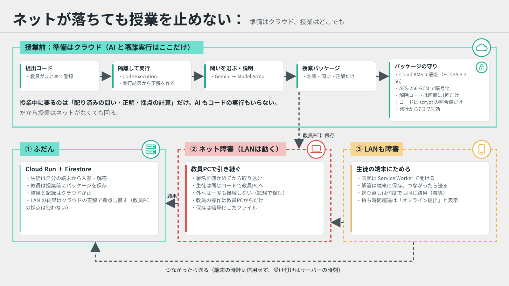

# ムシトリ（仮称）

自分の書いたコードを本人が分かっているかを、授業の5分で確かめるツールです。

提出コードを隔離環境で実行して問いと正解を作り、生徒が授業中に解きます。教員は誤答をもとに、持ち時間の中で声をかける順を決めます。正解と採点はコードの実行結果で決まり、AIは使いません。Geminiは問いの選定と、つまずきの説明を担当します。

セキュリティの概要は下の「[セキュリティ](#セキュリティ)」に、詳しい対策は [SECURITY.md](SECURITY.md) に、ネットが落ちても授業を止めない仕組みは [MODES.md](MODES.md) にまとめています。

このリポジトリは開発用です。審査は提出用リポジトリ（`Devfest-Hackathon-2026/df-2026-t032`）の内容で行われるので、最終版は提出期限までにそちらへ移します。

## 手元で動かす

```sh
uv venv --python 3.12 .venv
uv pip install -r requirements-dev.txt
.venv/bin/python -m pytest
sh scripts/dev.sh
```

ブラウザで http://localhost:8000 を開き、「デモクラスを作る」から試せます。

> `scripts/dev.sh` は生徒のコードを隔離せずに手元で動かします。合成データ専用で、実在の提出物には絶対に使わないでください。

## 構成

| 場所 | 役割 |
| --- | --- |
| `qgen/harness.py` | 隔離環境の中で動く実行ラッパー。標準ライブラリのみ |
| `qgen/sandbox.py` | 実行環境の切り替え（本番は Code Execution） |
| `qgen/questions.py` | 実行結果から問いと正解を作る |
| `qgen/ai.py` | Gemini の呼び出しと出力の検査。失敗時はテンプレートに戻す |
| `qgen/guard.py` | Gemini に渡す文と返答を Model Armor で検査する |
| `app/main.py` | FastAPI の API |
| `app/auth.py` | 教員と生徒の認証、用途ごとの鍵 |
| `app/security.py` | セキュリティヘッダー、本文の上限、接続元の判定 |
| `app/audit.py` | 監査ログ（Cloud Logging の形式） |
| `app/offline_api.py` | 授業パッケージ、校内LAN版、オフライン提出の API |
| `app/classpack.py` | 授業パッケージの署名（Cloud KMS）、暗号化、コードの照合値 |
| `app/lan_store.py` | 校内LAN版の保存先（暗号化したファイル） |
| `scripts/lan.py` | 校内LAN版を教員PCで起動する |
| `web/offline.js`、`web/sw.js` | 送れなかった解答をためる、画面をオフラインでも開く、授業パッケージの画面 |
| `app/ordering.py` | 声をかける順の計算 |
| `app/service.py` | 提出の読み込み、採点、処理の流れ |
| `app/store.py` | 保存先の共通の操作と、手元用のメモリ版 |
| `app/firestore_store.py` | 本番用の Firestore 版 |
| `firestore.rules` | ブラウザからの読み書きをすべて拒否するルール |
| `web/` | 教員と生徒の画面（デモ） |
| `tests/unit/` | 単体テスト |
| `tests/integration/` | 結合テスト |

## テスト

```sh
.venv/bin/python -m pytest                    # すべて
.venv/bin/python -m pytest tests/unit         # 単体テストだけ
.venv/bin/python -m pytest tests/integration  # 結合テストだけ
```

| 場所 | 試すもの | 新しいテストを置く基準 |
| --- | --- | --- |
| `tests/unit/` | 関数やクラス1つ | コードを実行せず、APIも通さない。外部とのやりとりは偽物に置き換える |
| `tests/integration/` | 部品をつないだ動き | APIを通す、または合成コードを実際に実行する |

- どちらも本物の Code Execution と Gemini は呼びません。手元の実行環境（`LocalDevSandbox`）とテンプレート（`TemplateAI`）を使います。
- 結合テスト専用の準備は `tests/integration/conftest.py` に置きます。単体テストからは使えません。
- pytest の設定は `pyproject.toml` にあります。

Firestore 版も試すときは、公式エミュレータの中で結合テストを動かします。Java 21 以上と Node.js が必要です。`demo-` で始まるプロジェクトはクラウドに接続しません。

```sh
npx firebase-tools@15.35.0 emulators:exec --only firestore --project demo-mushitori ".venv/bin/python -m pytest tests/integration"
```

エミュレータがあると、保存先を使う試験はメモリ版と Firestore 版の両方で動きます。

## 環境変数

`.env.example` を参照してください。指定がないときは本番用の設定（Firestore、Code Execution）で動き、`SESSION_SECRET` がなければ起動後の処理を拒否します。

`SESSION_SECRET` からは用途ごとの鍵（トークンの署名、授業コードと個人コードのハッシュ、接続元のハッシュ）を導出します。変えると保存済みのコードで入室できなくなるので、本番では固定した値を Secret Manager に置きます。

生徒のデータ（提出コード、解答、採点結果など）は、課題を作ってから `RETENTION_DAYS` 日（既定30日）で消えます。教員は課題やクラスをすぐに消すこともできます（`DELETE /v1/assignments/{id}`、`DELETE /v1/classes/{id}`）。

`AI_BACKEND=gemini` で本番として動かすときは、`MODEL_ARMOR_TEMPLATE` が必須です。ないときは Gemini を使わずテンプレートで動きます。テンプレートの作り方は [SECURITY.md](SECURITY.md#デプロイのときに行う設定) にあります。

## セキュリティ



生徒のコードも、AI への入力も、ブラウザからの値も「信用できないデータ」として扱い、層を重ねて守ります。Google が公開している考え方（[SAIF](https://saif.google/secure-ai-framework)、Strict CSP と Trusted Types、鍵の用途分離、最小権限）に沿っています。

| 層 | していること | 主な場所 |
| --- | --- | --- |
| ブラウザ | 厳しい CSP と Trusted Types、クリックジャッキング対策、HSTS。本番の画面は CSP を Report-Only から始める | `app/security.py`、`firebase.json` |
| 認証 | 教員は Firebase のログインと許可リスト、生徒は署名付きトークン。鍵は `SESSION_SECRET` から用途ごとに導出。入室の失敗は接続元ごとに Firestore で数える | `app/auth.py`、`app/main.py` |
| 生徒のコードの実行 | Code Execution の中でさらに、危ない書き方（`__import__`、`open`、特殊な属性）を断り、環境変数を渡さず、メモリと CPU 時間を制限する | `qgen/harness.py` |
| AI | 生徒由来の文はデータとして囲み、Gemini の前後を Model Armor で検査する。検査できなければテンプレートに戻す | `qgen/guard.py`、`qgen/ai.py` |
| データ | 30日で自動削除（TTL と API の両方）、教員がすぐ消せる、ブラウザから DB は触れない、監査ログにコードや IP を残さない | `app/store.py`、`app/audit.py` |
| 障害に強い | 授業パッケージ（Cloud KMS で署名、暗号化）で、教員PCが校内LANだけで授業を引き継ぐ。生徒の端末は解答をためて後で送る | `app/offline_api.py`、`web/offline.js` |




### main に取り込むときに変わること

- 授業コードと個人コードのハッシュの作り方が変わるので、今あるクラスのコードでは入れなくなります。デモクラスは作り直してください。
- `AI_BACKEND=gemini` の本番で `MODEL_ARMOR_TEMPLATE` がないと、Gemini を使わずテンプレートで動きます。
- 授業パッケージは署名の鍵（`PACKAGE_SIGNING_KMS_KEY`）がないと作れません（503）。授業そのものには影響しません。
- クラスを作るときに照合値（scrypt）を計算するので、生徒1人あたり数十ミリ秒かかります。
- デプロイ前後の設定は [SECURITY.md の「デプロイのときに行う設定」](SECURITY.md#デプロイのときに行う設定) にまとめています。

## 本番の構成

公開URLは https://mushitori-hackathon.web.app です（2026年11月6日にデプロイ）。画面は Firebase Hosting から配信し、Cloud Run のURLには画面を置いていません。

| 部品 | 設定 |
| --- | --- |
| Firebase Hosting | `web/` を配信し、`/v1/**` を Cloud Run の `mushitori`（`asia-northeast1`）へ転送する（`firebase.json`） |
| Firebase Auth | Google ログイン。教員は `TEACHER_EMAILS` のアカウントだけを通す |
| Cloud Run | 誰でも呼べる設定。サービスアカウント `mushitori-run` には Firestore と Agent Platform の利用権限だけを付ける |
| Secret Manager | `mushitori-session-secret` を `SESSION_SECRET` として渡す |
| Code Execution | 実行環境を1つ作り、`SANDBOX_RUNTIME_NAME` で渡す。指定しないと問いを作るたびに新しく作られる |

Cloud Run の環境変数は `APP_ENV=production`、`STORE_BACKEND=firestore`、`AI_BACKEND=gemini`、`SANDBOX_BACKEND=code_execution`、`TEACHER_EMAILS`、`ALLOW_DEMO_SEED=1`、`SERVE_WEB=0` などです。

再デプロイは、このリポジトリを置いた Cloud Shell で行います。`gcloud run deploy` は、指定しない設定（環境変数、サービスアカウント、公開範囲）をそのまま引き継ぎます。

```sh
gcloud run deploy mushitori --source . --region asia-northeast1 --project mushitori-hackathon --quiet
firebase deploy --only hosting,firestore:rules --project mushitori-hackathon
```

教員を増やすときは、`TEACHER_EMAILS` をカンマ区切りで書き換えます。値にカンマを含むので、区切り文字を `^:^` で変えます。

```sh
gcloud run services update mushitori --region asia-northeast1 --project mushitori-hackathon --update-env-vars '^:^TEACHER_EMAILS=a@example.com,b@example.com'
```

## まだできていないこと

- **Cloud Storage：** 仕様では提出コードと実行の記録を Storage に置きますが、今は Firestore の文書に入れています。1文書の上限を超えそうな提出は「出力が多すぎる」として対象外にします。
- **入室の試行回数の制限：** 失敗した入室だけを、接続元ごとに毎分30回まで Firestore で数えます（インスタンスをまたいで効きます）。Cloud Run では `X-Forwarded-For` の右端を接続元とします。記録を自動で消す TTL の設定と、デプロイ後に接続元が正しく分かれるかの確認が残っています（[SECURITY.md](SECURITY.md#デプロイのときに行う設定)）。
- **Model Armor、Cloud KMS：** 検査と署名のコードと試験はありますが、テンプレートと鍵はまだ作っていません。
- **画面の CSP：** 本番の画面ではまだ Report-Only です。違反がないことを確かめてから強制にします。
- **TTL：** 期限の印は書いていますが、Firestore の TTL の設定はまだです。設定するまでは、期限後のデータは API から見えなくなるだけで、DB には残ります（[SECURITY.md](SECURITY.md#デプロイのときに行う設定)）。
- **Cloud Run Jobs：** 問いの生成はAPIの中のバックグラウンド処理です。本番ではジョブに分けます。
- **Cloud Shell へのコードの持ち込み：** GitHub との連携を設定していないので、今は手作業で送っています。
- **Classroom 連携、`.ipynb` 対応：** 未着手です。

## データの扱い

- 実在の生徒の提出物は使いません。デモは `app/demo.py` の合成データです。
- 評価用データの候補 [ai-cet/paper-neurips23-gaied](https://github.com/ai-cet/paper-neurips23-gaied) は CC BY-NC-SA 4.0 です。公開の提出用リポジトリには含めず、`data/` に置きます（Git の管理外）。
- APIキーや鍵はコミットしません。提出用リポジトリは公開されるので、履歴ごと持ち込まないでください。
