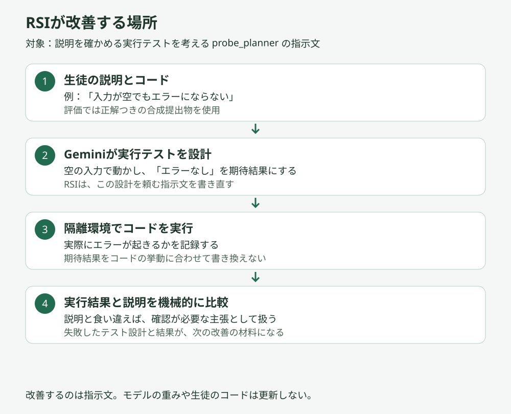
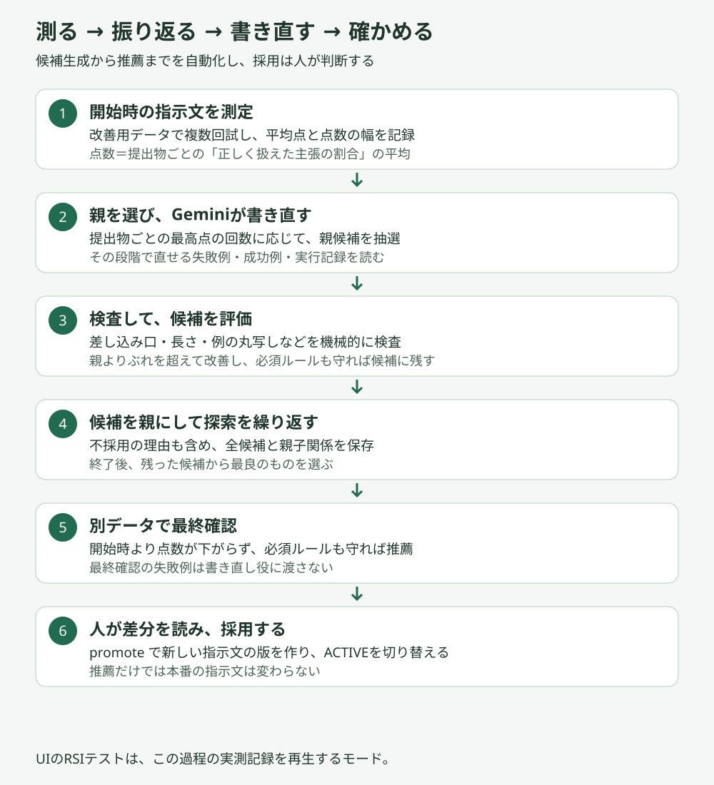

# RSI：失敗例から、AIへの指示文を改善する

[README](./README.md) ｜ **RSI** ｜ [Security](./SECURITY.md)

ムシトリのRSIは、**生徒の説明を確かめる実行テストをGeminiに考えさせる指示文を、評価結果から繰り返し改善する仕組み**です。現在の対象は `probe_planner` の1段階です。モデルの重みを再学習する処理ではなく、指示文の候補を作って比較する開発用の改善ループです。

> [!NOTE]
> RSI と、改善した指示文を使う `probe_planner`（[`apps/api/qgen/probes.py`](./apps/api/qgen/probes.py)）は、今は評価ハーネスの中で検証している段階です。授業の流れ（公開 URL の教員と生徒の画面）にはまだ組み込んでいません。

## 何を改善している？



たとえば、生徒が「入力が空でもエラーにならない」と説明した場合、確かめたいのは「空の入力で実行し、エラーが起きないか」です。Geminiがコードを読んで「実際にはエラーになる」と気づき、期待結果を「エラーになる」に直してしまうと、説明の間違いを見逃します。

RSIはこうした失敗を読み、「期待結果は生徒の主張どおりに設定し、実際のコードに合わせて修正しない」と指示を明確にします。実際の結果はコードの実行で確かめます。

## 改善ループ



1. **開始時を測る。** 正解つきの合成提出物を使い、同じ指示文を複数回評価します。平均点と、最大点から最小点を引いた「ぶれ」を記録します。
2. **親を選ぶ。** 全体の平均点だけで選ばず、提出物ごとに最高点を取った回数に応じて、残っている候補から抽選します。
3. **書き直す。** 改善役のGeminiに、親の指示文、その段階で直せる失敗例、成功例、実行記録を渡します。
4. **検査して測る。** 差し込み口の変更、長さの増えすぎ、評価例の丸写し、偽のデータ囲みを検査します。通過した候補を改善用データで評価します。
5. **改善した候補を残す。** 原則として、親より平均点が開始時のぶれを超えて改善し、必須ルール違反がない候補を残します。ぶれがゼロで平均点が同じ場合は、一部の提出物で改善した候補も残します。
6. **最終確認する。** 探索後の最良候補と開始時の指示文を、別に確保したデータで比較します。候補の点数が下がらず、必須ルールを守れば推薦します。ここでも設定された回数だけ測定します。
7. **人が採用する。** 候補、点数、親子関係、不採用理由、差分を保存します。人が確認して `promote` を実行すると、新しい版を作成して `ACTIVE` を切り替えます。

点数は、提出物ごとの「正しく扱えた主張の割合」を平均したものです。改善役のAIには点数を付けさせません。AI呼び出しの失敗で既定の処理に戻った結果は、指示文の成績に混ぜません。

## 実測例

UIの既定の再生記録 `20261107-000819-probe_planner` では、各指示文を3回ずつ評価しました。

| 評価 | 開始時 c000 | 推薦候補 c006 |
|---|---:|---:|
| 改善用データ | 85.6% | 90.0% |
| 別に確保した最終確認用データ | 84.3% | 89.7% |

開始時の点数のぶれは2.8ポイントでした。c002は平均点が2.5ポイント上がりましたが、ぶれの範囲として候補に残していません。c006は、複数の入力値を省略せず読み取り、生徒の主張の期待結果を勝手に修正しない方向に指示を改善しました。

公開用に抜粋した記録は [`rsi-demo.json`](./apps/web/rsi-test-assets/rsi-demo.json) で確認できます。この成績は特定の合成データと評価構成での結果です。製品全体や実際の授業で同じ改善幅が出ることを示すものではありません。

## GEPAとの関係

[GEPA（Reflective Prompt Evolution）](https://arxiv.org/abs/2507.19457) の、実行記録を振り返って指示文を更新する考え方と、問題ごとの成績を使った親選択を取り入れています。公式ライブラリをそのまま使う構成ではなく、このプロジェクト向けの独自実装です。

| 要素 | 現在の実装 |
|---|---|
| 実行記録を使った反省・指示文の更新 | 実装済み |
| 問題ごとの最高点を使う親選択 | 実装済み。提出物ごとの最高点の回数で重み付け |
| 複数候補の長所を合成する交叉・マージ | 未実装 |
| 複数段階の指示文の最適化 | 現在は `probe_planner` のみ |
| 候補を残す条件 | 独自。親より平均点が改善することを原則とし、測定のぶれも考慮 |
| 採用までの運用 | 機械的検査、最終確認、人による採用を追加 |

親より平均点が低い候補は、特定の提出物に強くても通常は残りません。このため、GEPAの多様な候補を生かす探索を狭めています。「GEPAの完全再現」ではなく、**GEPAの主要な考え方を取り入れた指示文改善ループ**と位置づけています。

## UIで動きを見る

手元の開発環境で、リポジトリ直下から起動します。

```sh
sh apps/api/scripts/dev.sh --rsi-test
```

表示されたURLを開き、上部の **RSIテスト** を選びます。

- **テストを再生／一時停止**：候補の評価から最終推薦までを順にたどる。
- **次のステップ**：1ステップずつ確認する。
- **候補のボタン**：点数、採否の理由、指示文の差分、失敗例と実行記録を読む。
- **最初に戻す**：再生をやり直す。

これは保存済みの実測記録を再生するモードです。新しいAI呼び出し、コード実行、本番への反映は行いません。本番のFirebase Hostingではテスト記録を配信しません。

## 対象範囲と確認できていないこと

- 現在の評価では、主張の分解、実行以外の根拠探し、文面生成に模擬部品を使い、実行テストの設計段階を測っています。
- 最終確認用データの失敗例は、書き直し役には渡しません。ただし、その文やコードは丸写し検査の照合対象に含まれるため、探索と完全に独立した最終テストとまでは言えません。
- 授業中に製品全体を自動改変する仕組みではありません。生徒の理解度やAI使用を判定する指示文への変更も求めていません。

## 実装と操作手順

| ファイル | 役割 |
|---|---|
| [`rsi/loop.py`](./apps/api/rsi/loop.py) | 候補生成・評価・最終確認のループ |
| [`rsi/proposer.py`](./apps/api/rsi/proposer.py) | 失敗と実行記録を読む改善役 |
| [`rsi/objective.py`](./apps/api/rsi/objective.py) | 点数、ぶれ、親選択の計算 |
| [`rsi/checks.py`](./apps/api/rsi/checks.py) | 指示文の形式・丸写しの検査 |
| [`rsi/targets.py`](./apps/api/rsi/targets.py) | 改善対象と評価構成 |
| [`rsi/record.py`](./apps/api/rsi/record.py) | 記録の保存と人による採用 |
| [`DEVELOPMENT.md`](./apps/api/DEVELOPMENT.md) | 実際の改善ループを動かす手順 |

図は `python docs/make_rsi_diagrams.py` で再生成できます。
