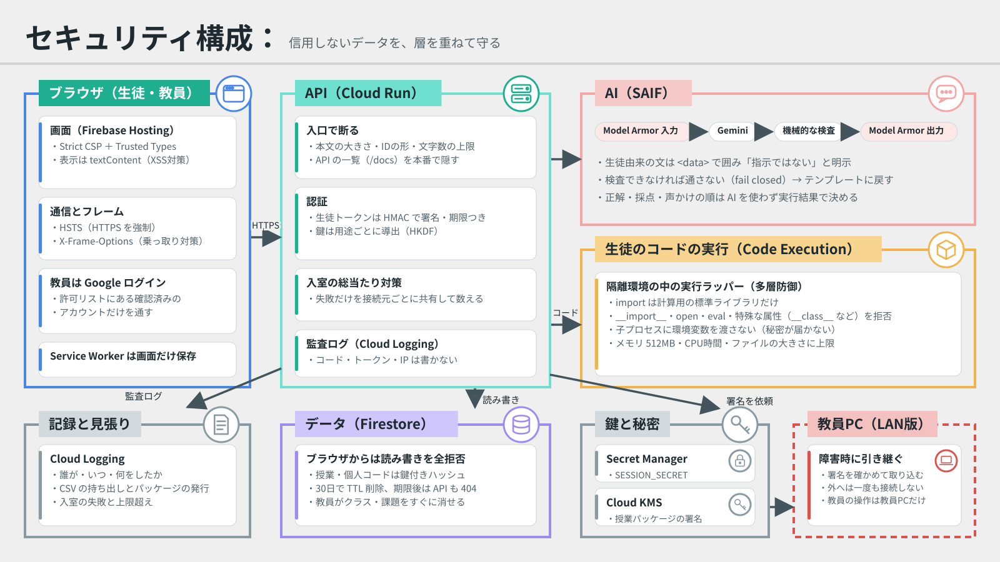

# セキュリティ設計

[README](./README.md) ｜ [RSI](./RSI.md) ｜ [Security](./SECURITY.md)

ムシトリは、高校生が書いたコードを実行し、その結果を Gemini に渡し、採点結果を教員に返します。生徒のコードもAIへの入力も「信用できないデータ」として扱うことを出発点に、Google が公開している考え方（[SAIF](https://saif.google/secure-ai-framework)、Strict CSP と Trusted Types、鍵の用途分離、最小権限）に沿って、層を重ねて守ります。

## 用語ミニ辞典

| 用語 | 一言でいうと | たとえ |
| --- | --- | --- |
| XSS | 画面に他人のスクリプトを紛れ込ませて動かす攻撃 | 画面の乗っ取り |
| CSP | 「この画面で動かしていいのは、このサイトの部品だけ」とブラウザに伝える設定 | 受付の名簿 |
| Trusted Types | 画面に HTML を差し込む操作を、決めた窓口だけに限る仕組み | 搬入口をひとつにする |
| HSTS | 「このサイトには必ず暗号化（HTTPS）でつなぐ」とブラウザに覚えさせる設定 | 裏口を閉める |
| HMAC 署名 | 秘密の鍵で押すハンコ。中身を書き換えるとハンコが合わなくなる | 偽造できない入館証 |
| HKDF | 1本の親鍵から、用途ごとに別々の鍵を作る | マスターキーから部屋ごとの鍵を作る |
| ハッシュ | 元に戻せない形に変えること。照合はできるが、元の文字は分からない | 指紋 |
| scrypt | わざと計算に時間がかかるハッシュ。片っ端から試すのを遅くする | 重い扉 |
| レート制限 | 一定時間に試せる回数の上限 | 何度も間違えるとロックされる ATM |
| サンドボックス | 外に影響が出ないよう切り離した実行場所 | 防護ガラスの中の実験 |
| プロンプトインジェクション | AI への入力に「指示を無視して」などを紛れ込ませ、AI を操る攻撃 | AI をだます |
| Model Armor | AI への入力と AI の答えを検査する Google Cloud のサービス | 行きも帰りも通る手荷物検査 |
| TTL | 決めた時刻が来たら、データを自動で消す Firestore の機能 | 期限が来ると動くシュレッダー |
| Secret Manager | パスワードや鍵を保管する Google Cloud のサービス | 金庫 |
| Cloud KMS | 鍵を外に出さずに、署名や暗号化だけをしてくれる Google Cloud のサービス | 印鑑を預けて、押してもらう |
| ECDSA 署名 | 誰でも「本物か」を確かめられる署名。授業パッケージに付ける | 封筒の封印 |
| AES-GCM | データを暗号化し、書き換えられたことも見つける方式 | 鍵つきの箱 |
| 監査ログ | だれが・いつ・何をしたかの記録 | 顔は映さない防犯カメラ |
| Report-Only | CSP を「止めずに報告だけする」モードで試すこと | 本番前の試運転 |

## 守るもの

| 守るもの | 漏れたり書き換えられたりすると |
| --- | --- |
| 生徒の提出コード、解答、採点結果 | 生徒の学習の記録が他人に見られる。成績に近い情報が外に出る。必要以上に長く残ること自体も危険を増やす |
| 授業コードと個人コード | 他人になりすまして解答できる |
| 教員のアカウントと操作 | クラスの作成、締切、CSVの持ち出しを他人にされる |
| サーバーの権限（Firestore、Gemini、Code Execution） | データの全件取得や、費用のかかる呼び出しをされる |
| 教員画面に出る文面 | 生徒が AI を操って、教員の判断を誤らせる |
| 生徒ごとの記録 | 課題をまたいだ学習の様子が、必要以上に長く残る。持ち主以外に見られる |

## 想定する攻撃

| 誰が | 何をしようとするか |
| --- | --- |
| 生徒 | 他の生徒の問いや結果を見る。正解を先に知る。持ち時間を延ばす。提出コードで隔離を破る。コードや答えに指示を書いて Gemini を操り、教員画面に「確認不要」などと出させる |
| 外部 | コードの総当たり。教室全体を締め出す大量の失敗。XSS やクリックジャッキング。大きな本文や zip 爆弾でサーバーを止める |
| 内部の誤り | 秘密をログやリポジトリに残す。本番で開発用の設定のまま動かす |

## 信頼の境界



```
 生徒・教員のブラウザ ──HTTPS──▶ Firebase Hosting ──▶ API（Cloud Run）──▶ Firestore（ブラウザからは全拒否）
   CSP + Trusted Types                                  │  鍵付きハッシュ、署名付きトークン、監査ログ
                                                        ├──▶ Code Execution（生徒のコードを隔離して実行）
                                                        │      └ 実行ラッパー：使える部品を絞り、環境変数なし、メモリ上限
                                                        ├──▶ Model Armor ──▶ Gemini ──▶ Model Armor ──▶ 機械的な検査
                                                        └──▶ Cloud KMS（授業パッケージの署名）
 教員PC（校内LAN版）：署名を確かめて授業パッケージを取り込む。外へは接続しない（docs/offline.md）
```

境界をまたぐ値は、受け取った側でもう一度確かめます。隔離環境の出力、Gemini の返答、ブラウザからの入力は、どれも信用しません。

## 対策

### 認証と認可

| 対策 | 場所 |
| --- | --- |
| 教員は Firebase の ID トークンで確かめる。署名、発行元、期限に加えて、失効と無効化も確かめる（`check_revoked`）。メールの確認済みと許可リスト（`TEACHER_EMAILS`）の両方が必要 | `apps/api/app/auth.py` |
| 生徒のトークンは HMAC-SHA256 で署名し、版（`v`）、種類（`typ`）、期限を必ず確かめる。署名を確かめる前に中身を読まない。形が違うものはすべて理由を区別せず 401 | `apps/api/app/auth.py` |
| 鍵は `SESSION_SECRET` から HKDF で用途ごとに導出する（トークンの署名、コードのハッシュ、接続元のハッシュ）。1つの用途の値が漏れても、他の用途の鍵にならない | `apps/api/app/auth.py` |
| 授業コードと個人コードは鍵付きハッシュだけを保存する。平文で返すのはクラスを作った1回だけ | `apps/api/app/main.py` |
| 教員はクラスごとに持ち主を確かめ、生徒はトークンのクラスに属する課題しか触れない。見つからないときも、他人のものだったときも同じ 404 | `apps/api/app/main.py` |
| 入室の失敗は、接続元ごと・1分ごとに Firestore で数える。インスタンスが増えても上限は変わらない。正しいコードの入室は数えないので、教室全員が同じ回線でも締め出されない | `apps/api/app/main.py`、`apps/api/app/store.py` |
| 授業コードが違うときも個人コードの照合と同じだけ読み、応答時間からどちらが違ったかを推測させない | `apps/api/app/main.py` |
| Cloud Run では `X-Forwarded-For` の右端（Cloud Run が足した値）だけを信用する。左側は送り手が偽れる。IPv6 は /64 単位で数える | `apps/api/app/security.py` |

### 生徒のコードの実行（多層防御）

隔離は Code Execution が担います。その内側で、実行ラッパーがさらに次の制限をかけます。

| 対策 | 場所 |
| --- | --- |
| `import` は計算用の標準ライブラリだけ | `apps/api/qgen/harness.py` |
| `__import__`、`open`、`eval`、`exec`、`getattr` などの組み込み関数と、`__class__` のような特殊な属性を使うコードは実行せず「対応していない書き方」として先生に知らせる | `apps/api/qgen/harness.py` |
| 生徒のコードを動かす子プロセスには環境変数を渡さない。手元の開発でも `SESSION_SECRET` は届かない | `apps/api/qgen/harness.py`、`apps/api/qgen/sandbox.py` |
| メモリ（512MB）、書き込むファイルの大きさ、CPU 時間に上限をかける。メモリを食いつぶすコードは「実行時にエラー」で止まる | `apps/api/qgen/harness.py` |
| 説明の「動き」の主張を確かめる実行（`mode=probe`、関数を1つ呼ぶ）にも、上の import と名前の検査、環境変数なし、資源の上限を同じようにかける。主張とコードは `<data>` で囲み、Model Armor で検査してから Gemini に渡す。囲みと注意書きはコードが付けるので、指示文の自動改善（`apps/api/rsi/`）でも外れない | `apps/api/qgen/harness.py`、`apps/api/qgen/probes.py` |
| 隔離環境が返した結果は形を確かめてから使う。対象外の理由は決めた値だけを保存し、それ以外は `error` にする | `apps/api/qgen/sandbox.py`、`apps/api/app/service.py` |

### AI（SAIF のリスクとの対応）

| SAIF のリスク | 対策 |
| --- | --- |
| Prompt Injection | 生徒由来の文（コード、実行の記録、生徒の答え、振り返りの質問とやりとり、説明を聞きたい行のコード）は `<data>` で囲み、指示ではないと明示する。問いの選定、解説、質問案、クラスのまとめ、振り返りの対話のすべてで同じ扱いにする。閉じタグを中に書いても外に出られない。生徒の答えは先頭200字だけを渡す。Gemini に渡す前に Model Armor のプロンプトインジェクション・ジェイルブレイク検出にかける |
| Insecure Model Output | 返答は JSON スキーマで受け取り、形、長さ、評価する言葉、記録にない数値、行番号、URL を機械的に確かめる。さらに Model Armor の有害表現（RAI）と悪意のある URL の検出にかけてから人に見せる |
| Sensitive Data Disclosure | Gemini にはコメントを消したコードと、出席番号を含まない値だけを渡す。Model Armor の Sensitive Data Protection（基本設定）で機密データを検出する |
| Rogue Actions | Gemini には何の操作もさせない。正解、採点、声をかける順はすべてコードの実行結果と計算で決まり、Gemini の返答は問いの選定と文面だけに使う |
| Denial of ML Service | Gemini と Model Armor のどちらかが失敗したら、テンプレートに戻す。授業は止まらない |

Model Armor が使えないときは「通さない」に倒します（fail closed）。検査の失敗、一部のフィルタの失敗（`PARTIAL`）も通しません。本番で `AI_BACKEND=gemini` なのに `MODEL_ARMOR_TEMPLATE` がないときは、Gemini を使わずテンプレートで動きます（`apps/api/qgen/ai.py` の `default_ai`）。

Model Armor は Gemini の呼び出しに組み込む方法もありますが、その方法は Model Armor に届かないときに検査なしで通ってしまうことがあるため、API を直接呼んで結果を自分で判定しています。

### ブラウザ

| 対策 | 内容 |
| --- | --- |
| Content Security Policy | `default-src 'none'` から始めて、自分の配信元のスクリプト、スタイル、通信だけを許す。インラインのスクリプトは置かない。本番の画面は Firebase Hosting が配るので、`firebase.json` で同じ方針（Firebase の配信元だけを追加）を付ける。Google が勧める進め方どおり、まず Report-Only で出し、本番で違反がないことを確かめてから強制に切り替える |
| Trusted Types | `require-trusted-types-for 'script'`。`innerHTML` などに文字列を入れる書き方そのものをブラウザが拒否する。画面の文字はすべて `textContent` で入れている。許すポリシーは Service Worker の登録用の `mushitori` だけ |
| クリックジャッキング | `frame-ancestors 'none'` と `X-Frame-Options: DENY` |
| その他のヘッダー | `X-Content-Type-Options: nosniff`、`Referrer-Policy`、`Cross-Origin-Opener-Policy: same-origin-allow-popups`（Google ログインのポップアップを壊さない）、`Cross-Origin-Resource-Policy`、`Permissions-Policy` |
| HTTPS | 本番では HSTS（2年、サブドメインを含む） |
| キャッシュ | API の応答は `Cache-Control: no-store`。トークン、コード、結果を共有の端末やプロキシに残さない |
| 実装を明かさない | 本番では `/docs` と `/openapi.json` を出さない。`server` ヘッダーを送らない |

### 入力と資源

| 対策 | 内容 |
| --- | --- |
| 本文の大きさ | ハンドラーが読む前に 16MB 余りで断る。`Content-Length` がない送り方でも、受け取りながら数えて断る |
| ID | サーバーが作る形（16桁の16進数）以外は、保存先に問い合わせる前に断る |
| 文字数と件数 | 標準入力の例は1件2000字まで、解答は10問まで、持ち時間の計算は0〜3600秒 |
| zip | 展開せずに読む。ヘッダーの大きさは偽れるので、実際に読んだ量で1ファイル64KB、合計8MBを確かめる（zip 爆弾対策）。暗号化、重複、壊れたファイルは1件ずつ知らせ、全体は止めない |
| CSV | `=`、`+`、`-`、`@` などで始まる値は先頭に `'` を付け、表計算ソフトで数式として動かないようにする。添付ファイルとして返す |

### データの扱い

- **保存期間：** 生徒のデータ（提出コード、問い、正解、解答と採点結果、声かけの記録）は、課題を作ってから `RETENTION_DAYS` 日（既定30日、1〜365日）で消します。期限は課題を作るときに決めて変えません。必要な結果は教員が CSV で持ち出せます。
- **二重に消す：** Firestore では課題とその下の文書の1つずつに同じ `expire_at` を書き、TTL で消します（TTL は親を消しても子を消さないため）。TTL の削除は期限から遅れることがあるので、期限を過ぎた課題は API がどの入口からも 404 を返し、削除を待たずに見えなくします。
- **生徒ごとの記録：** 課題をまたいで積み上げる記録（`classes/{id}/students/{sid}`）は、記録の1件ずつに元の課題と同じ期限を持たせ、読むときと書くときに期限の過ぎたものを外します。文書の `expire_at` は最後まで残る記録の期限にして TTL で消します。課題を消すとその課題の分を記録から外し、クラスを消すと記録ごと消えます。生徒が書いた行の説明は解答の文書に入るので、解答と一緒に消えます。
- **教員がすぐ消せる：** `DELETE /v1/assignments/{id}` で課題とその生徒のデータを、`DELETE /v1/classes/{id}` でクラス、名簿、授業コードと個人コード、クラスのすべての課題を消します。持ち主の教員だけが消せ、消した記録は監査ログに残ります。クラスを消すときは授業コードを最初に消して、新しい入室を止めます。配布済みのトークンも、課題が見つからなくなるので使えません。
- 実在の生徒の提出物は使いません。デモは合成データです。
- 名簿は出席番号だけを持ち、氏名は受け付けません。Gemini にはコメントを消して渡すので、コメントに書いた氏名も届きません。
- 接続元は鍵付きハッシュにしてから保存・記録します。入室の失敗の記録は TTL で自動的に消えます。
- Firestore はブラウザからの読み書きをすべて拒否し、サーバーだけが触ります（`firestore.rules`）。

### ネットが落ちても授業を止める仕組み

授業前に「授業パッケージ」を教員PCに保存し、ネットが落ちたら教員PCが校内LANだけで授業を引き継ぎます。生徒の端末は送れなかった解答をためておきます。詳しい流れは [docs/offline.md](docs/offline.md) にあります。

| 想定する攻撃 | 対策 |
| --- | --- |
| 偽の授業パッケージを教員PCに読ませる | クラウドが ECDSA P-256 で署名し（本番は Cloud KMS、秘密鍵はアプリの外）、教員PCは事前に保存した公開鍵で確かめる |
| パッケージのファイルが漏れる | AES-256-GCM で暗号化。鍵は1回だけ画面に出す解除コードから導き、どこにも保存しない。コードは scrypt の照合値だけ。発行から7日で失効 |
| 教室の端末から教員PCを操作する | 教員の操作は 127.0.0.1 からだけ。LAN に開くのは入室と解答だけ。問いを作る操作は校内LAN版では使えない |
| 教員PCで結果を書き換える | クラウドに戻すときは、教員PCの採点を使わずクラウドの正解で採点し直す。クラウドで先に提出されたものを正とする |
| 校内LAN版が外と通信する | クラウドの設定が残っていたら起動しない。外への接続が一度もないことを試験で確かめる |
| 端末の時計をずらして持ち時間を延ばす | 受け付けた時刻はサーバーの時刻。持ち時間を過ぎたものには「オフライン提出」の印を付けて先生に見せる。開始から1日を過ぎたものは受け付けない |
| 共用の端末に生徒のデータが残る | Service Worker は画面の部品だけを置き、問いや結果は置かない。ためた解答は送れたらすぐ消す |

### 監査と検知

`apps/api/app/audit.py` が Cloud Logging の形式（JSON 1行、`severity` 付き、リクエストのトレースと結びつけ）で次を記録します。

| 記録 | 内容 |
| --- | --- |
| `class.created`、`assignment.created`、`submissions.uploaded`、`generation.started`、`assignment.opened`、`assignment.closed`、`followup.recorded` | 教員の操作。誰が、どの課題に |
| `assignment.deleted`、`class.deleted` | データの削除。誰が、どれを |
| `export.downloaded` | CSV の持ち出し。誰が、いつ、何人分 |
| `student_record.viewed` | 生徒ごとの記録（課題をまたいだ様子）を、誰が、どの生徒について見たか |
| `login.succeeded`、`login.failed`、`login.rate_limited` | 入室。接続元はハッシュで |
| `teacher.auth_failed`、`teacher.not_allowed` | 教員の認証の失敗と、許可されていないアカウント |
| `package.issued`、`package.imported`、`package.rejected`、`edge.results_exported`、`edge.results_imported`、`attempt.offline_submitted` | 授業パッケージの持ち出しと取り込み、校内LANの結果、オフライン提出 |

記録に入れてよい項目は決めてあり、それ以外の名前を渡すと記録する前に例外になります。コード、トークン、生徒のコード、生の IP アドレスは記録しません。試験でもこれを確かめています。

Model Armor が検出したときは、どのフィルタが反応したかを警告として記録します。

## デプロイのときに行う設定

アプリのコードは上の対策を備えています。次の設定は Google Cloud 側で、デプロイのときにチームが行います。

1. **秘密を Secret Manager に置く。** `SESSION_SECRET` は環境変数に直接書かず、Secret Manager から渡します（`gcloud run deploy --set-secrets SESSION_SECRET=session-secret:latest`）。値を変えると、保存済みのコードで入室できなくなります。
2. **専用のサービスアカウントで動かす。** 既定の Compute Engine のアカウントは使わず、必要なロールだけを付けます。`roles/datastore.user`（Firestore）、`roles/aiplatform.user`（Gemini と Code Execution）、`roles/modelarmor.user`（Model Armor）、`roles/secretmanager.secretAccessor`（その秘密だけに付ける）、`roles/cloudkms.signerVerifier`（授業パッケージの鍵だけに付ける）。
3. **Model Armor のテンプレートを作る。** 日本語の検出には多言語の検出が必要で、`asia-northeast1` は対応していないため、`us` に作ります。Gemini はすでに `global` で呼んでいるので、データの所在の条件は変わりません。

   `gcloud` の Model Armor のコマンドは、地域のエンドポイントを指定しないと権限があっても `PERMISSION_DENIED` になります（2026年11月6日に確認）。

   ```sh
   export CLOUDSDK_API_ENDPOINT_OVERRIDES_MODELARMOR=https://modelarmor.us.rep.googleapis.com/
   gcloud model-armor templates create mushitori-guard --location=us \
     --pi-and-jailbreak-filter-settings-enforcement=enabled \
     --pi-and-jailbreak-filter-settings-confidence-level=low-and-above \
     --rai-settings-filters='[{"filterType":"HATE_SPEECH","confidenceLevel":"MEDIUM_AND_ABOVE"},{"filterType":"HARASSMENT","confidenceLevel":"MEDIUM_AND_ABOVE"},{"filterType":"SEXUALLY_EXPLICIT","confidenceLevel":"MEDIUM_AND_ABOVE"},{"filterType":"DANGEROUS","confidenceLevel":"MEDIUM_AND_ABOVE"}]' \
     --malicious-uri-filter-settings-enforcement=enabled \
     --basic-config-filter-enforcement=enabled \
     --template-metadata-log-sanitize-operations
   ```

   作ったら `MODEL_ARMOR_TEMPLATE=projects/<プロジェクト>/locations/us/templates/mushitori-guard` を設定します。日本国内での処理が必要な場合は `asia-northeast1` に作り、`MODEL_ARMOR_MULTI_LANGUAGE=0` にします（ただし日本語の文は検出されないことがあります）。

4. **TTL を有効にする。** 課題、その下の生徒のデータ、入室の失敗の記録が、期限を過ぎると消えるようになります。TTL は文書の種類（コレクショングループ）ごとに設定します。`students` は生徒ごとの記録です。

   ```sh
   for group in assignments submissions quizzes answerKeys attempts followups students loginFailures; do
     gcloud firestore fields ttls update expire_at --collection-group="$group" --enable-ttl
   done
   ```

5. **接続元の判定を確かめる。** Cloud Run に直接つなぐ場合は何もしなくても右端の1つを信用します（`K_SERVICE` で判定）。Firebase Hosting を通すと中継が1段増える見込みですが、公式の説明がないため、デプロイ後に入室の監査ログの `forwarded`（`X-Forwarded-For` の項目数）を見て `TRUSTED_PROXY_HOPS` を決めます。合っていないと、全員が同じ接続元に見え、失敗の上限を全員で共有してしまいます。
6. **授業パッケージの署名の鍵を作る。** 秘密鍵は Cloud KMS の外に出ません。Cloud Run のサービスアカウントには、その鍵にだけ署名の権限を付けます。

   ```sh
   gcloud kms keyrings create mushitori --location=asia-northeast1
   gcloud kms keys create class-package --keyring=mushitori --location=asia-northeast1 \
     --purpose=asymmetric-signing --default-algorithm=ec-sign-p256-sha256
   gcloud kms keys add-iam-policy-binding class-package --keyring=mushitori --location=asia-northeast1 \
     --member=serviceAccount:mushitori-run@mushitori-hackathon.iam.gserviceaccount.com --role=roles/cloudkms.signerVerifier
   ```

   `PACKAGE_SIGNING_KMS_KEY=projects/mushitori-hackathon/locations/asia-northeast1/keyRings/mushitori/cryptoKeys/class-package/cryptoKeyVersions/1` を設定します。設定がないと、授業パッケージは作られません（503）。
7. **画面の CSP を強制に切り替える。** デプロイしたら、ログインから締切までを一通り操作し、開発者ツールのコンソールに CSP の違反が出ないことを確かめます。出なければ `firebase.json` の `Content-Security-Policy-Report-Only` を `Content-Security-Policy` に変えて、もう一度デプロイします。
8. **（任意）トークンの失効も確かめる。** サービスアカウントに `roles/firebaseauth.viewer` を付けてから `FIREBASE_CHECK_REVOKED=1` にします。付けずに有効にすると、全員がログインできなくなります。

## まだできていないこと

- **エッジでの防御：** Cloud Armor（WAF、IP 単位の上限、ボット対策）はロードバランサーが必要なので入れていません。アプリ側の上限は接続元ごとなので、多数の接続元からの分散した総当たりには効きにくいです。ただしコードは授業コードと個人コードの両方が必要で、それぞれ31種類の文字の8桁です。
- **画面の CSP：** 本番の画面では、まだ Report-Only です。上の手順 7 で強制に切り替えます。
- **校内LAN版の証明書：** 教員PCが作る自己署名の証明書は、生徒の端末に信頼させるまで警告が出ます。学校の管理コンソールから配る手順が要ります。保存ファイルの鍵は OS の鍵保管庫ではなく、権限を絞ったファイルに置いています。
- **ソフトウェアの供給網：** ベースイメージは digest で、Python のパッケージはハッシュで固定していません。Artifact Registry の脆弱性スキャンと Binary Authorization も未設定です。
- **準備まで完全にオフラインにする：** 教員PCでのコードの隔離実行（WebAssembly）とローカルの AI は設計だけです（[docs/offline.md](docs/offline.md)）。
- **名簿の保存期間：** クラス（出席番号の名簿、担当教員のメール、コードのハッシュ）は、教員が消すまで残ります。生徒のデータより重さは低いですが、年度の終わりに消す運用が必要です。
- **本番での確認：** Model Armor、Cloud KMS の署名、Firestore の入室の数え方と TTL の印は、偽の応答と（Firestore は）エミュレータで試す作りですが、本物の Google Cloud ではまだ動かしていません。

## 確かめ方

```sh
cd apps/api
.venv/bin/python -m pytest tests/unit/test_auth.py tests/unit/test_security.py tests/unit/test_guard.py tests/unit/test_classpack.py \
  tests/integration/test_security_api.py tests/integration/test_retention_api.py tests/integration/test_offline_api.py
```

| 試験 | 確かめること |
| --- | --- |
| `apps/api/tests/unit/test_auth.py` | 壊れた、偽造した、形の違う、期限切れのトークンがすべて 401 になる。鍵が用途ごとに違う |
| `apps/api/tests/unit/test_security.py` | 偽の `X-Forwarded-For` で接続元を偽れない。CSV の数式が無害になる |
| `apps/api/tests/unit/test_guard.py` | Model Armor が検出した文や、検査に失敗した文が Gemini にも画面にも届かない。生徒の答えが `<data>` の外に出られない |
| `apps/api/tests/unit/test_service.py` | zip 爆弾、暗号化、重複、壊れたファイル。隔離環境が返す偽の理由を保存しない |
| `apps/api/tests/unit/test_classpack.py` | 解除コードがないと読めない、別の鍵の署名や改ざん、期限切れを拒む。偽の Cloud KMS で署名と CRC32C の確認 |
| `apps/api/tests/integration/test_offline_api.py` | 校内LANでの授業の一巡と、結果をクラウドで採点し直すこと。教室の端末から教員の操作ができない、クラウドのトークンが通らない、再起動しても続く、保存ファイルが暗号化されている、外への接続が一度もない、送り直しが冪等 |
| `apps/api/tests/integration/test_retention_api.py` | 期限を過ぎた課題、消した課題やクラスに、教員からも生徒からも届かない。Firestore では生徒のデータの文書すべてに TTL の印がある |
| `apps/api/tests/integration/test_security_api.py` | ヘッダー、本番の設定、不正な ID や本文で 500 にならない、入室の上限がインスタンス間で共有される、隔離を破ろうとするコードが対象外になる、監査ログにコードが残らない |
